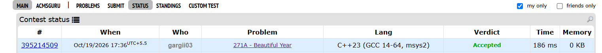
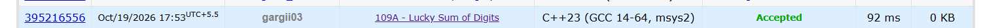

BEGINNER

Solution:

Created an array of all digits from 0 to 9.Now started checking for next distinct year by starting from year+1. Extracted digits from the year and marked them in the array now if same number is there we put distinct=false hence break and check for next year.

TC-O(1)
SC-O(1)

Code:
#include <iostream>
using namespace std;

int main() {
    int y;
    cin >> y;

    for (int year = y + 1; ; year++) {
        int temp = year;
        bool used[10] = {false};
        bool distinct = true;

        while (temp > 0) {
            int digit = temp % 10;

            if (used[digit]) {
                distinct = false;
                break;
            }

            used[digit] = true;
            temp /= 10;
        }

        if (distinct) {
            cout << year << endl;
            break;
        }
    }

    return 0;
}

INTERMEDIATE:
The number can be represented as (4a + 7b = n), where a is the number of 4s and b is the number of 7s.
Since we want the minimum lucky number, we first try to use the maximum possible number of 7s because they contribute more to the digit sum than 4s.We start the loop with b = n / 7, as this is the maximum possible number of 7s, and continue until b becomes 0.For each value of b, we calculate the remaining sum by subtracting 7 * b from n. We then check whether the remainder is divisible by 4. If it is, we can find a by dividing the remainder by 4.Once we find a valid combination, we print all the 4s first, followed by all the 7s, to obtain the minimum number. If no valid combination exists, we print -1.

Code:
#include <iostream>
using namespace std;

int main() {
    int n;
    cin >> n;

    for (int b = n / 7; b >= 0; b--) {
        int rem = n - 7 * b;

        if (rem % 4 == 0) {
            int a = rem / 4;

            for (int i = 0; i < a; i++) {
                cout << 4;
            }

            for (int i = 0; i < b; i++) {
                cout << 7;
            }

            cout << endl;
            return 0;
        }
    }

    cout << -1 << endl;
    return 0;
}
